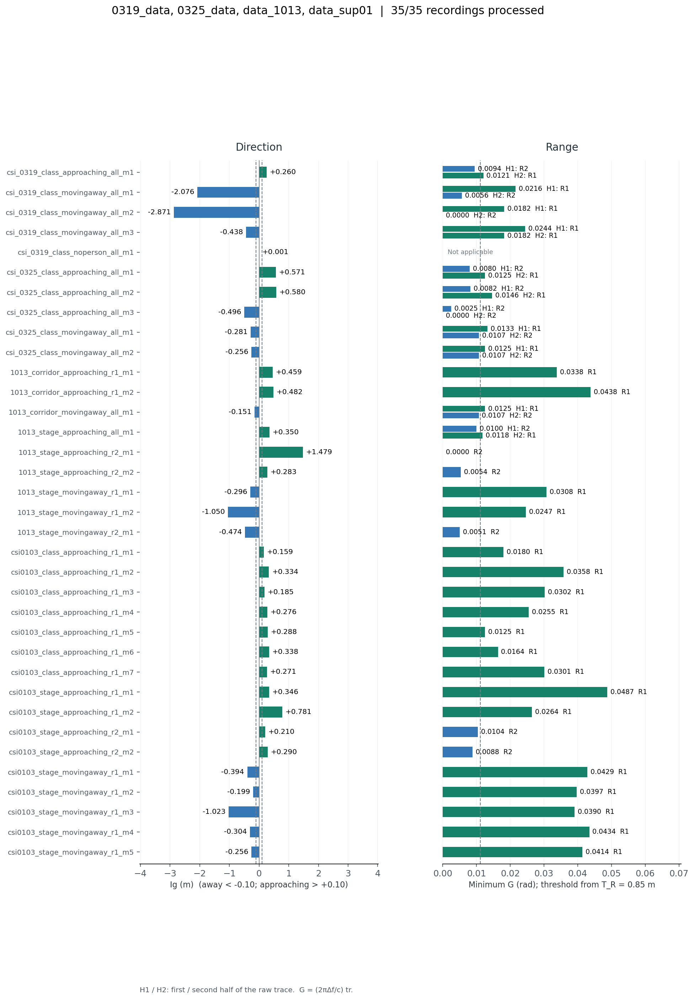

# CornerSense

CornerSense uses WiFi CSI on a mobile robot to detect human approach, departure,
and range around corners. This repository contains the Python processing
pipeline, 35 recorded examples with saved results, and two dynamic-path
simulations.

| Example | Processing | Entry point |
|---|---|---|
| Recorded data | Intel 5300 CSI, angle estimation, session calibration, and motion/range inference | [run.py](run.py) |
| 2 dynamic paths | Synthetic CSI, aug-CSI power projection, and power comparison | [README](simulation_2_dynamic_paths/README.md) |
| 4 dynamic paths | Synthetic CSI, aug-CSI power projection, and power comparison | [README](simulation_4_dynamic_paths/README.md) |

## Installation

Use Python 3.11–3.13. Run the following commands from the repository root:

```bash
python -m venv .venv
source .venv/bin/activate
python -m pip install -r requirements.txt
```

On Windows, activate the environment with `.venv\Scripts\activate`.
NumPy, SciPy, and Matplotlib versions are pinned in [requirements.txt](requirements.txt).

## Recorded examples

Process a recording session:

```bash
python run.py --input sample/0319_data
python run.py --input sample/0325_data
python run.py --input sample/data_1013
python run.py --input sample/data_sup01
```

Process all samples and check the results:

```bash
python run.py --input sample --output results/recorded_samples --workers 2
python verify.py --results results/recorded_samples/results.json
```

Use a new directory for `--output`. Omitting this option creates a timestamped
directory under `results/`. Each run decodes the CSI, estimates angles, and
computes the metric curves. Recording names and format are described in
[sample/README.md](sample/README.md). Add `--verbose` to display intermediate
processing diagnostics.

### Saved results

Session offsets were selected using these 35 recordings and their labels;
the table reports performance on this calibrated sample set.

| Recording folder | Recordings | Correct motion | Correct range | Both correct |
|---|---:|---:|---:|---:|
| 0319_data | 5 | 5/5 | 3/4 | 3/4 |
| 0325_data | 5 | 4/5 | 4/5 | 4/5 |
| data_1013 | 9 | 9/9 | 9/9 | 9/9 |
| data_sup01 | 16 | 16/16 | 16/16 | 16/16 |
| Total | 35 | 34/35 | 32/34 | 32/34 |

Motion includes the `noperson` prediction for one recording in `0319_data`.
That recording is classified correctly. Range and combined scores cover the
34 human-motion recordings. The two
combined mismatches are `csi_0319_class_movingaway_all_m3` (R1 → R1 instead of
R1 → R2) and `csi_0325_class_approaching_all_m3` (moving away, R2 → R2 instead
of approaching, R2 → R1).

[sample_results/](sample_results) contains the overview, per-recording curves,
NPZ arrays, and JSON/CSV summaries.



### Metrics and outputs

The path metric is `tr = abs(Dphys)`, in metres. The motion indicator `Ig` is
the median of the final 20% of `tr` minus the median of the first 20%:

- `Ig > 0.10 m`: approaching.
- `Ig < −0.10 m`: moving away.
- Otherwise: `noperson`.

R1 and R2 follow the range-region definitions and experimental settings in
the [CornerSense paper](REFERENCES.md). The implemented range classifier uses
the path metric: `min(tr) > 0.85 m` for R1 and `min(tr) ≤ 0.85 m` for R2.

Plots also express the path metric as the paper's phase metric,
`G = (2π Δf / c) tr`, in radians. The conversion uses the pipeline's effective
spacing `Δf = 625000 Hz` and propagation speed `c = 299792458 m/s`, giving a
range threshold of approximately `0.011134 rad`. NPZ files contain both
`tr_m` and `G_rad`; JSON and CSV summaries report their minima. Motion and
range decisions use `tr`, and `Ig` is reported in metres.

See [PARAMETERS.md](PARAMETERS.md) for parameter definitions, candidate selection,
and calibration formulas.

### Session calibration

Each recording's measured reference-path and human-path AoAs are corrected
using the session offset in
[calibration/sample_angles.json](calibration/sample_angles.json). The values
and subtraction formula are listed in [PARAMETERS.md](PARAMETERS.md#recorded-data-angle-calibration).
Use `--calibration` to select another file with the same structure. Result
metadata includes the calibration settings used for the run.

### Labels and evaluation

Filenames encode scene, motion, and range labels, which are used to score the
inference results. For human-motion recordings with the `all` range label,
range is evaluated separately before and after the midpoint of the original
recording timeline.

Recordings with no person or with robot-only motion use the `no_person` label.
The corresponding prediction is `noperson` when −0.10 ≤ Ig ≤ +0.10 m.
Range evaluation for these recordings is marked as not applicable.

## Dynamic-path simulations

```bash
python -m simulation_2_dynamic_paths.run --output results/simulation_2_dynamic_paths
python -m simulation_4_dynamic_paths.run --output results/simulation_4_dynamic_paths
```

Both experiments generate 8 s of noiseless analytic CSI at 400 Hz, using three
antennas and the pipeline's 30 subcarrier frequencies. The receiver is stationary.

| Project | Input paths | aug-CSI power projection: correlation / RMSE | Raw-power component: correlation / RMSE |
|---|---|---|---|
| [2 dynamic paths](simulation_2_dynamic_paths/README.md) | Two dynamic paths and one weak static background path | 0.958 / 0.206 | −0.400 / 1.182 |
| [4 dynamic paths](simulation_4_dynamic_paths/README.md) | Four dynamic paths with decreasing amplitudes and distinct length-change rates | 0.929 / 0.266 | 0.009 / 0.994 |

Both simulations use the CornerSense pipeline for angle estimation and signal
processing. The raw-power comparison uses its smoothing, bandpass, and PCA
functions. Each experiment produces two figures:

- Cosine comparison: the aug-CSI power projection and raw-power PCA component
  alongside the reference/virtual-path cosine truth. The extracted components
  are centered and normalized by `sqrt(2) × RMS`. The table reports full-window
  correlation and RMSE against that truth.
- Power comparison: raw power `|H|²` and augmented power `|H + H_a|²`
  from the same antenna and subcarrier.

Shared generation, processing, and plotting code is described in the
[simulation tools README](cornersense/simulation/README.md).
Each experiment folder includes its configuration, entry points, plotted
curves, report, and figures in PNG and SVG. A new run also saves the synthetic
CSI, path truth, and processing intermediates. Redraw the included results with:

```bash
python -m simulation_2_dynamic_paths.make_figures simulation_2_dynamic_paths/results
python -m simulation_4_dynamic_paths.make_figures simulation_4_dynamic_paths/results
```

## Pipeline and project structure

The CornerSense pipeline applies virtual-path augmentation, first-stage PCA,
power-domain beat-frequency cancellation, second-stage PCA,
distance-anchor/phase-displacement readout, and robot-motion compensation.
Recorded CSI is processed using its sampling timestamps.

```text
CornerSense/
├── cornersense/                 Processing, evaluation, and plotting
│   └── simulation/              Shared dynamic-path simulation code
├── run.py / verify.py           Recorded-data execution and result checks
├── sample/                      35 CSI recordings in four session folders
├── calibration/                 Session angle calibration
├── sample_results/              Saved recorded-data results
├── simulation_2_dynamic_paths/  Two-dynamic-path experiment and results
├── simulation_4_dynamic_paths/  Four-dynamic-path experiment and results
├── tests/                       Pipeline, calibration, label, and result tests
├── tools/                       Result plotting scripts
├── LICENSE / DATA.md            License and data description
└── CITATION.cff / REFERENCES.md  Paper citation and method references
```

New runs write to `results/` or the selected output directory. `.gitignore`
excludes temporary outputs, caches, and virtual environments.

For the recorded-data implementation, start with
[inference.py](cornersense/inference.py), which decodes CSI, estimates and
corrects angles, and calls [pipeline.py](cornersense/core/pipeline.py).
[spotfi.py](cornersense/core/spotfi.py) implements spatial/frequency-smoothed
MUSIC. [PARAMETERS.md](PARAMETERS.md) describes the numerical settings.

## Tests

```bash
python -m unittest discover -s tests -v
python -m unittest simulation_2_dynamic_paths.test_simulation simulation_4_dynamic_paths.test_simulation -v
python verify.py --results sample_results/results.json
```

`tests/` covers pipeline numerics, labels, calibration, and saved-curve scoring.
The simulation tests cover signal generation, pipeline integration, intermediate
exports, component scoring, and repeatability.

## License and citation

The project authors' code, documentation, recordings, synthetic data, and
figures are available under [CC BY-NC 4.0](LICENSE). Third-party materials
retain their respective licenses. See [DATA.md](DATA.md) for data attribution
and use.

The associated paper is *CornerSense: Virtual Path-augmented WiFi Sensing for
Human Proximity Detection Around Corners on Mobile Robots*, Proceedings of the
ACM on Interactive, Mobile, Wearable and Ubiquitous Technologies, 9(4),
Article 181, 2025. DOI: `10.1145/3770699`.

See [CITATION.cff](CITATION.cff) for citation metadata and
[REFERENCES.md](REFERENCES.md) for the paper and SpotFi method references.
